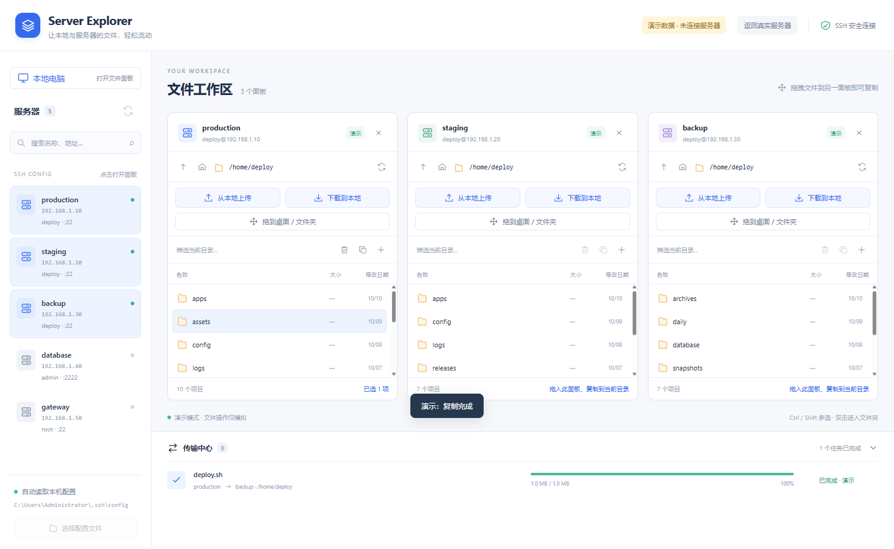

# Server Explorer

让本地与服务器的文件，轻松流动。

Server Explorer 是一款面向 **Windows** 的桌面文件管理工具。它读取已有的 SSH 配置，将本地电脑和多台服务器放在同一个工作区，让你通过拖拽完成上传、下载和跨服务器复制。

无需在服务器上安装额外的应用；连接和身份验证由本机 OpenSSH 处理，远程文件操作通过 SFTP 完成。



*截图来自内置演示模式，使用模拟服务器与文件数据。*

## 功能特点

- **多面板浏览**：同时打开本地电脑和多台服务器，独立切换目录、筛选文件。
- **沿用 SSH 配置**：自动发现 `Host` 别名，支持密钥、密码、ssh-agent 和跳板机配置。
- **拖拽复制**：支持本地与远程双向传输、跨服务器复制，以及文件夹递归复制。
- **服务器端复制**：同一服务器内复制时，文件内容无需经过本机。
- **传输中心**：查看进度、排队状态和错误，取消任务，处理同名文件覆盖或跳过。
- **常用文件操作**：多选、新建文件夹、重命名、递归删除及右键菜单。
- **与 Windows 桌面交互**：从资源管理器拖入文件，或将准备下载好的远程文件拖到桌面与文件夹。
- **内置演示**：无需配置服务器即可体验工作区，不连接真实服务器、不操作真实文件。

## 快速开始

### 环境要求

| 项目 | 要求 |
| --- | --- |
| 本机系统 | Windows；当前打包目标为 x64 |
| SSH 客户端 | 已安装 OpenSSH，且 `ssh` 可从命令行调用 |
| 远程服务器 | 可通过 SSH 连接，并启用 SFTP v3 子系统 |
| SSH 配置 | 默认读取 `%USERPROFILE%\.ssh\config`，也可在应用内选择其他文件 |

使用已打包的程序无需安装 Node.js。可以在 PowerShell 中检查 OpenSSH 是否可用：

```powershell
ssh -V
```

### 启动应用

从 [Releases 页面](https://github.com/qusica/server-explorer/releases/latest)下载 `Server-Explorer-<版本>-Windows.exe`，双击启动即可，无需安装。

也可以按下方的[开发与构建](#开发与构建)说明，从源码运行。

### 配置服务器

在 `%USERPROFILE%\.ssh\config` 中添加明确的主机别名。例如：

```sshconfig
Host production
    HostName 192.0.2.10
    User deploy
    Port 22
    IdentityFile ~/.ssh/id_ed25519

Host staging
    HostName 192.0.2.20
    User deploy
    IdentityFile ~/.ssh/id_ed25519

# 通过跳板机连接
Host bastion
    HostName 192.0.2.30
    User jump
    IdentityFile ~/.ssh/id_ed25519

Host private-server
    HostName 10.0.0.10
    User deploy
    ProxyJump bastion
    IdentityFile ~/.ssh/id_ed25519
```

将示例地址、用户名和密钥路径替换为自己的配置。使用密码登录时，可省略 `IdentityFile`；应用会在连接时弹出身份验证窗口。

`Host *`、`Host web-*` 等通配符配置用于匹配规则，不会直接列为服务器。应用会发现 `Include` 文件中的明确别名，再交由 `ssh -G` 解析生效配置，包括 `Match`、`ProxyJump` 和 `ProxyCommand` 等规则。

### 第一次使用

1. 打开应用，左侧会自动列出 SSH 配置中的服务器。修改配置后点击刷新；使用其他配置时点击「选择配置文件」。
2. 点击服务器打开面板，按提示核对首次连接的主机指纹并完成身份验证。点击「本地电脑」可打开本地面板。
3. 双击文件夹进入目录，或在地址栏输入绝对路径后按 Enter。远程路径如 `/home/deploy`，本地路径如 `C:/Users/your-name/Downloads`；本地也支持 UNC 共享路径。
4. 选择文件或文件夹，拖到目标面板，核对来源和目标后确认复制。进度会显示在下方传输中心。

## 使用说明

### 上传、下载和复制

| 操作 | 方法 |
| --- | --- |
| 上传本地文件 | 拖到服务器面板，或点击「从本地上传」选择文件或文件夹 |
| 下载远程文件 | 先选中项目，点击「下载到本地」，选择保存目录并确认 |
| 跨服务器复制 | 将文件从来源服务器面板拖到目标服务器面板 |
| 复制到指定文件夹 | 将文件拖到目标面板内的文件夹行 |
| 手动指定目标 | 选中项目后点击复制按钮，选择目标面板并输入目录 |
| 从资源管理器上传 | 将 Windows 文件资源管理器中的文件或文件夹拖到服务器面板 |
| 将远程文件拖到桌面 | 点击「拖到桌面 / 文件夹」，等待下载准备完成，再拖出弹窗中的文件卡片 |

拖到面板空白处或普通文件行时，目标为该面板的当前目录。拖回原目录会直接忽略，不创建传输任务。复制保留来源文件。

右键菜单提供下载、复制到其他面板、重命名和删除等操作；本地文件的「上传到」菜单会列出当前已连接的服务器。右键空白处可以新建文件夹或刷新。重命名遇到同名项目时会拒绝覆盖。

### 快捷键

以下文件操作快捷键在文件列表获得焦点时生效。

| 快捷键 | 操作 |
| --- | --- |
| `Ctrl` + 单击 | 选择或取消选择多个项目 |
| `Shift` + 单击 | 连续选择 |
| `Ctrl+A` | 选择当前筛选结果 |
| `F2` | 重命名所选项目 |
| `Delete` | 确认后永久删除所选项目 |
| `Backspace` | 返回上级目录 |
| `Ctrl+R` | 刷新当前面板；焦点不在面板内时重新读取 SSH 配置 |

## 连接与传输机制

### 身份验证与本地数据

SSH 连接由本机 OpenSSH 执行，沿用现有密钥文件、ssh-agent 和代理配置。应用不自行解析或保存私钥、密码；密码与密钥口令通过带随机令牌的本机命名管道交给 OpenSSH，不写入应用日志或磁盘。

首次连接需要确认主机指纹，主机记录由 OpenSSH 写入配置的 `known_hosts`。已记录的主机密钥发生变化时，OpenSSH 会阻止连接。

应用会保存所选 SSH 配置文件的路径。使用「拖到桌面 / 文件夹」时，远程文件会先下载到应用数据目录下的 `desktop-files` 缓存；超过一天的缓存会在下次启动时清理。

### 数据如何传输

| 场景 | 实现方式 |
| --- | --- |
| 本地与服务器之间 | 使用 SFTP 流式上传或下载 |
| 不同服务器之间 | 经本机内存流式中转，无需服务器之间互相建立 SSH 连接，也不将整份文件暂存到本机磁盘 |
| 同一服务器内 | 优先使用 SFTP `copy-data` 扩展；不支持时通过额外 SSH 连接执行远程 `cp` |

同服务器判断依据为解析后的主机、用户、端口与代理配置，因此通过不同别名打开的面板也可使用服务器端复制。旧服务器的 `cp` 兼容方式可能再次要求身份验证；若既不支持复制扩展，也不允许执行远程命令，同服务器复制会报错。

传输任务按顺序执行，浏览多个服务器不受任务排队影响。符号链接保留链接本身，不遍历其指向的内容；FIFO、设备等特殊文件不支持复制。

### 冲突、取消与删除

- 同名文件可以覆盖或跳过，并将选择应用到本次任务的后续冲突；同名文件夹会合并，文件与文件夹类型不同的冲突只能跳过。
- 文件先写入目标目录内的隐藏 `.part` 临时文件，完成后再改名。远程覆盖要求支持 `posix-rename@openssh.com`；不支持时任务会报错并保留原文件。
- 取消任务会保留此前已完成的文件，并清理正在复制的临时文件。文件夹复制不是整体事务；强制退出或连接中断可能留下临时文件，需要手动清理。
- **删除为永久删除，不进入回收站**。文件夹会递归删除，符号链接只删除链接本身；删除前会列出位置和项目供确认。
- 有未完成传输的位置需要先取消任务或等待完成，才能删除、重命名或关闭连接。连接尚未建立时，可以关闭面板并确认「强制关闭」以取消连接。

## 开发与构建

### 开发环境

- Windows 与可从命令行调用的 OpenSSH 客户端。
- Node.js **22.12.0 或更高版本**及 npm。
- Windows .NET Framework 的 C# 编译器，用于构建 `SSH_ASKPASS` 辅助程序。构建脚本默认查找 `%WINDIR%\Microsoft.NET\Framework64\v4.0.30319\csc.exe`。

在项目根目录运行：

```powershell
# 安装锁定版本的依赖
npm ci

# 构建身份验证辅助程序并启动 Electron 应用
npm start
```

### 检查与测试

```powershell
# 确保身份验证辅助程序已构建（干净检出后需要）
node scripts/build-askpass.js

# JavaScript 语法检查
npm run check

# 配置解析、本地文件操作、SSH/SFTP 集成与页面来源校验测试
npm test

# Electron 界面测试
npm run test:ui
```

集成测试使用本机 OpenSSH 连接临时 `ssh2` 测试服务，覆盖身份验证、递归复制、中文文件名、同名冲突、取消及服务器端复制等场景。界面测试使用 Playwright；其中 `scripts/test-ui.js` 要求默认 SSH 配置中至少存在一个可解析的明确 `Host` 别名，但不会主动连接该服务器。

### 打包

```powershell
# 生成 Windows x64 便携版单文件程序
npm run build

# 生成解包版应用目录
npm run pack
```

产物位于 `dist/`：便携版为 `Server-Explorer-<版本>-Windows.exe`，解包版为 `win-unpacked/`。当前构建未配置商业代码签名。

### 项目结构

```text
server-explorer/
├── src/
│   ├── main.js             # Electron 主进程、窗口和 IPC
│   ├── preload.js          # 页面可调用的最小接口
│   ├── backend/            # SSH 配置、SFTP、传输与文件操作
│   └── renderer/           # 工作区界面与样式
├── resources/             # 应用图标与 Askpass C# 源码
├── scripts/               # 构建、语法检查与界面测试脚本
├── test/                  # 自动化测试与临时 SSH 服务
├── docs/images/           # README 演示截图
└── package.json
```

界面采用原生 HTML、CSS 和 JavaScript。Electron 页面启用沙箱与上下文隔离，禁用页面内 Node.js，通过 preload 暴露受限接口。运行时由 OpenSSH 承载连接，应用实现 SFTP v3 文件操作；`ssh2` 用于测试服务。

## 常见问题

**为什么左侧没有服务器？**

确认默认配置文件存在，或点击「选择配置文件」。只有明确的 `Host` 别名会显示，通配符不会自动展开为主机列表。

**提示找不到 OpenSSH 怎么办？**

安装 Windows OpenSSH 客户端，并确认 PowerShell 中可以执行 `ssh -V`；安装或调整 PATH 后重新启动应用。

**命令行 SSH 可以登录，但应用无法浏览目录？**

应用还要求服务器启用 SFTP v3 子系统。请检查 SFTP 配置、目录访问权限以及应用显示的具体错误。

**能否在 macOS 或 Linux 使用？**

当前面向 Windows，构建脚本和身份验证辅助程序依赖 Windows 环境；尚未提供 macOS 或 Linux 支持。

**支持断点续传或并行传输吗？**

当前任务顺序执行，未实现断点续传。取消后重新发起任务会重新复制尚未完成的文件。

**符号链接复制后为什么无法使用？**

应用保留链接原始目标路径，跨机器或目录复制后可能需要手动调整。在 Windows 本地创建符号链接还需要相应系统权限。

## 参与贡献

欢迎通过 Issues 报告问题或提出功能建议，通过 Pull Request 提交改进。报告问题时请说明应用版本、Windows 版本、操作步骤和错误提示，并按需提供去除敏感信息的 SSH 配置片段。

提交代码前请运行与改动相关的检查和测试。不要在问题报告、截图或提交中包含密码、私钥或真实服务器的敏感信息。

## 自动发布

GitHub Actions 会在推送到 `main` 或提交 Pull Request 时运行 Windows 检查、测试与打包。推送 `v<版本>` 标签时，Release 工作流会验证标签与 `package.json`、`package-lock.json` 的版本一致，完成测试与打包后自动创建 Release，附上 Windows x64 便携程序和 `SHA256SUMS.txt`。

发布新版本时，在干净的工作区运行以下命令（以补丁版本升级为例）：

```powershell
# 更新两个包文件的版本，并创建版本提交与标签
npm version patch

# 推送主分支和版本标签，触发自动发布
git push origin main --follow-tags
```

也可以在仓库 Actions 页的 `Release` 工作流中点击 `Run workflow`，输入已有的版本标签。发布使用 GitHub 自动提供的 `GITHUB_TOKEN`，无需另行添加访问令牌。构建失败时不会发布 Release；已发布的同名 Release 不会被自动覆盖。

## 许可证

本项目采用 [MIT License](LICENSE)。
